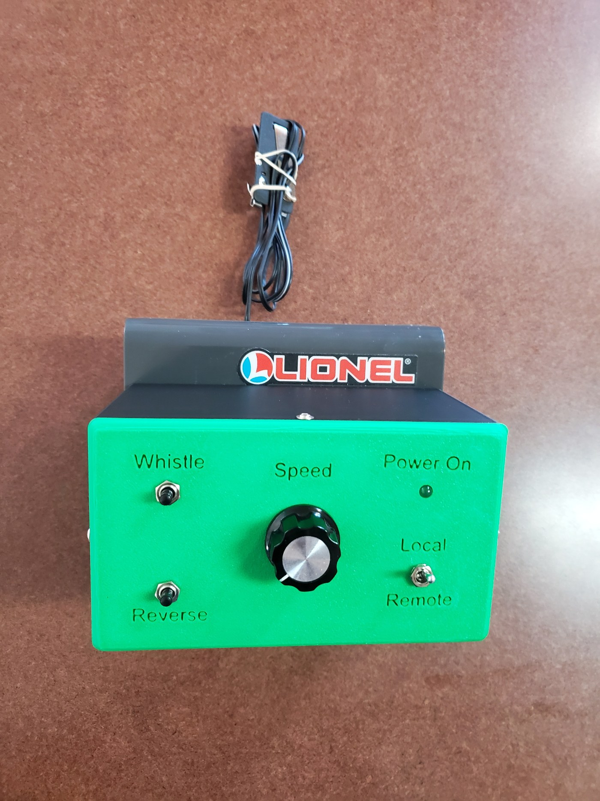
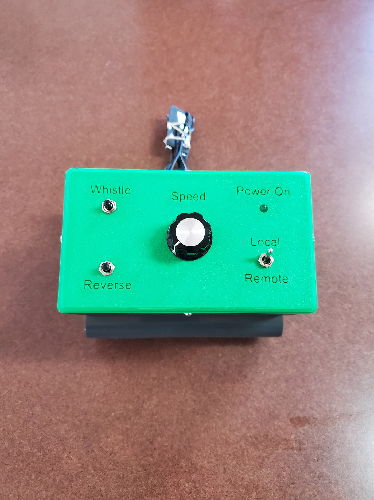

# Lionel O27 Controller — Proto V1.0

**Current matched release: UI v1.5 · FW v1.13**

UI v1.7 / FW v1.16 is untested on hardware.
UI v1.8 / FW v1.17 is untested on hardware.

<!-- PROTO-HERO-START -->

  

<h2 align="center">Operational Proto V1.0</h2>

  <strong>Arduino Nano ESP32 · BLE Remote Control · MG90S Throttle</strong> 
  <strong>UI v1.5 · FW v1.13</strong>

This is the completed operational prototype of the remotely controllable
**Lionel AC1803000 O27 train controller**. The original controller housing and
manual controls are retained while adding Bluetooth remote operation through an
Arduino Nano ESP32.

The front panel provides **Whistle**, **Reverse**, **Speed**, **Power On**, and
**Local / Remote** controls. In Local mode the controller can be operated from
the physical panel; in Remote mode the throttle, whistle, and reverse functions
are controlled from the Web Bluetooth PWA.

  

> **Prototype status:** Operational hardware. Proto V1.0 uses UI v1.5 and
> FW v1.13.

<!-- PROTO-HERO-END -->

A BLE remote-control retrofit for the Lionel AC1803000 O27 controller using
an **Arduino Nano ESP32**, an **MG90S positional servo** for the stock speed
pot, and two **5 V Omron G6N-2-Y relays** for Whistle and Reverse.

The installable control app is the Web Bluetooth PWA at the repository root.
Wiring is documented in [`docs/WIRING_PROTO_V1.0.md`](./docs/WIRING_PROTO_V1.0.md).
Firmware notes are in [`firmware/README.md`](./firmware/README.md).

## Proto V1.0 architecture

- **Throttle actuator:** MG90S servo, signal on Nano `D2`.
- **Throttle HOME/OFF:** `1000 us`, full clockwise viewed looking down at the
  top of the MG90S.
- **100% UI throttle:** `2200 us`. Full native-pot travel is intentionally not
  required.
- **Startup:** command HOME, hold PWM for 1200 ms, then remove PWM so the servo
  is not left holding at the home position. PWM automatically re-enables on
  the first later throttle movement.
- **Reverse relay:** Nano `D6`, active-HIGH into a 2N2222 low-side driver.
- **Whistle relay:** Nano `D7`, active-HIGH into a 2N2222 low-side driver.
- **Local/Remote switch:** Nano `D8`.
- **Local throttle pot:** Nano `A0`.
- **Control app:** installable Web Bluetooth PWA at the repository root
  (`index.html`).
- **UI v1.5:** full 0–100 dial face; slider sends one speed command only when
  released.
- **Local takeover:** Remote→Local uses soft pickup; the local pot must reach
  or cross the current throttle before it takes control.

## Repository layout

- `firmware/Lionel_O27_Controller_Nano_ESP32_FW_v1_13/` — authoritative
  Arduino Nano ESP32 firmware.
- Repository root — UI v1.5 PWA (`index.html`, `sw.js`, `manifest.json`,
  `icon-192.png`, `icon-512.png`, `.nojekyll`, `make_icons.py`). No build step.
  GitHub Pages serves this directory.
- `docs/WIRING_PROTO_V1.0.md` — current wiring reference.
- `docs/photos/` — operational prototype photos used above.

## Web app

The app is a single-file React-via-CDN Web Bluetooth PWA. There is no build
step. Use a Web Bluetooth-capable Chromium browser. The published site is
[https://samdottle.github.io/Lionel-Train-remote-control/](https://samdottle.github.io/Lionel-Train-remote-control/).

### UI v1.5
- Entire 0–100 speed dial is visible.
- Major labels: 0, 25, 50, 75, 100.
- Slider display moves continuously while dragging.
- One throttle BLE write is sent on slider release.
- Horn is press-and-hold.
- Reverse is a momentary tap with visible pressed feedback.

### BLE transport
Throttle, Horn, and Reverse have independent characteristics and state. Their
writes pass through one promise queue only because Android/Chrome Web Bluetooth
does not allow overlapping GATT operations.

### PWA updates
Service-worker cache: `o27-v1.5`. Navigation is network-first to reduce stale
GitHub Pages installs after deployment.

## Prototype photos

Optimized photos in [`docs/photos/`](./docs/photos/) are used in this README.

- [`Operational front view`](./docs/photos/Proto_V1.0_operational_front_web.jpg)
- [`Operational alternate view`](./docs/photos/Proto_V1.0_operational_angle_web.jpg)

## First servo/coupling setup

On the first power-up, leave the MG90S coupling loose or disconnected.
FW v1.13 commands the servo to `1000 us`, its full-clockwise HOME position.
Place the AC1803000 speed pot at OFF and tighten the coupling in that
alignment.

There is no stepper homing search, no intentional stall, no current-sensing
home routine, and no home switch.

## BLE API

The protocol is unchanged from the earlier matched releases:

| Characteristic | Payload |
|---|---|
| Throttle | one binary byte, `0..100` |
| Horn | one byte: nonzero = held, `0` = released |
| Direction | any write requests one Reverse pulse |
| Status | JSON `{"throttle":0-100,"mode":"local"|"remote"}` |

## Safety

The Nano GPIO pins do **not** power the relay coils. `D6` and `D7` drive
2N2222 transistor stages. Each 5 V relay coil is powered from the 5 V rail
and must have a flyback diode across the coil.

The MG90S is powered from the 5 V rail, with a common ground shared with the
Nano. Do not power the servo from a GPIO pin.

The hardware track-power cutoff remains the independent emergency backstop.
